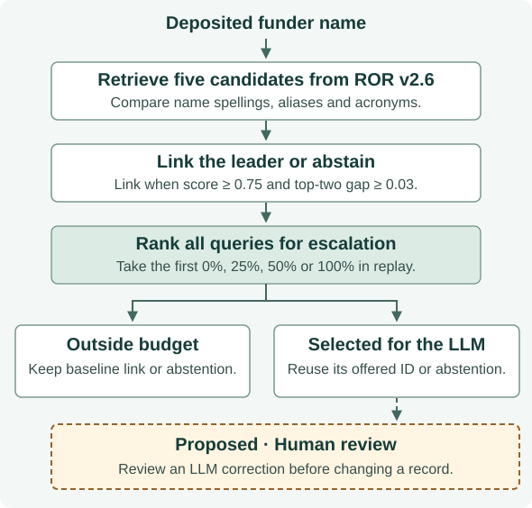
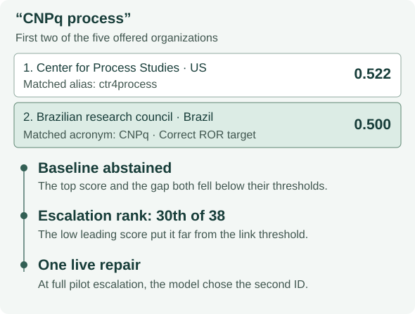

# When Should Entity Matching Escalate to an LLM?

When a funding analyst needs to link a name to an organization, which records justify paying for an LLM to take a second look? **I recommend deterministic matching with an explicit option to abstain. If an LLM suggests changing the decision, I would put that correction in front of a reviewer.**

| Baseline on development data | Observed LLM repairs | Live requests |
|---|---|---|
| **32/38** decisions correct | **1** missed link corrected | **4** distinct names, one call each |

The only repair was also the last name the routing rule would have sent. That made deciding *which* records to escalate as important as choosing a model. [Development results](../phase3d_crossref_resolution.md) · [Pilot decisions](../phase3e_live_findings.md)

## The implementation decision

A funding analyst wants variant spellings and acronyms to roll up to the same organization. A false link can credit the wrong institution. An abstention leaves a visible gap that someone can review. The useful business question is how many consequential errors a second decision would prevent, given the time, money and risk it adds.

I compared three ways to handle the same incoming name and registry shortlist.

| Alternative | What it buys | What it risks |
|---|---|---|
| Link by string similarity or abstain | Repeatable decisions with no model latency or API charge | Shared wording can favor the wrong organization. Acronyms can leave a real match unresolved. |
| Escalate a fraction of names | Spend model calls where a second reading might matter | A routing mistake can skip the case that needed help or send a correct decision for reconsideration. |
| Send every name to the model | Every offered candidate gets a second reading | Every record incurs model cost and latency. A missing candidate still cannot be selected. |

## How I evaluated the choice

The solid boxes describe the evaluation that ran. The dashed box shows where I would add an operator in a deployed workflow. Both linked and abstained records were eligible for escalation.

I used 38 development names from Crossref’s annotated funder data. Thirty had a target in the Research Organization Registry (ROR). Eight had no supported active match after one human review with AI-assisted research. For each name, lexical retrieval supplied five candidates from pinned ROR v2.6. The baseline linked the leader if its similarity was at least 0.75 and its lead over the runner-up was at least 0.03. Otherwise it abstained. Calibration used the same 38 names. [Dataset, baseline and grading](../phase3d_crossref_resolution.md) · [No-match review](../phase3e_readiness.md)

The four-query live pilot used a frozen shortlist for each query and a fixed prompt. GPT-6 Luna could return one offered ID or abstain. The runner acquired one response per query and reused it across escalation budgets. An exact ID or a correct abstention earned one correct decision. Separately, I checked whether retrieval had made each true match available in the first place. [Live pilot and replay](../phase3e_live_findings.md)

## What the baseline could resolve

**The baseline got 32 of 38 decisions right.** It got all 18 registry-form names right, compared with 8 of 12 alternative wordings and 6 of 8 no-matches. Five of its six errors could in principle be corrected using the offered choices. The sixth, “Hoffmann - LaRoche Pharmaceuticals,” had its true target at rank eight. Paying for a better selector would still leave that record unresolved. Across the 30 positive cases, retrieval offered the correct ID 29 times. [Baseline error analysis](../phase3f_escalation_analysis.md)

## Four live requests, four ways to use them

The model agreed with the baseline on the Pakistan and La Laguna links and the Hong Kong abstention. It changed one decision, for CNPq. Each row uses the same four names. The escalation percentage controls how many model responses replace baseline decisions in that replay. [Per-query pilot results](../phase3e_live_findings.md)

| Escalation | Responses used | Accuracy | Summed API latency | Estimated API cost from usage |
|---|---:|---:|---:|---:|
| 0% | 0 | 3/4 (75%) | 0 s | $0 |
| 25% | 1 | 3/4 (75%) | 1.678 s | $0.0000482 |
| 50% | 2 | 3/4 (75%) | 6.859 s | $0.0001083 |
| 100% | 4 | 4/4 (100%) | 9.643 s | $0.0002111 |

The four calls used **991 input and 224 output tokens**. The dollar figures apply the pilot-date rates to reported usage. The provider supplied no billed amount. The one-shot run reserved $0.00354375 against a $0.005 cap and completed without retries. The last two calls together added $0.0001028 and repaired one decision. Staff time, the downstream cost of a false link and savings from avoided review were outside the pilot. [Usage and spending controls](../phase3e_live_findings.md)

## Why the only repair came last

The word “process” matched a US organization's alias. The distinctive acronym “CNPq” belonged to the Brazilian agency in second place. The shortlist contained the answer. The routing rule kept this case out of the smaller budgets because it favored decisions near the link thresholds. The leading score of 0.522 fell well short of 0.75, so the close contest drew little priority. [Candidate scores and ranking](../phase3f_escalation_analysis.md)

Across all 38 names, the original rule brought **four of five** correctable errors into the first nine slots. Ranking by the smallest top-two gap brought **three** there. By slot 19 the counts were **four and five**. CNPq alone accounted for the extra opportunity. A routing opportunity can still produce a wrong answer, and the other 34 names have no live response. [Full offline comparison](../phase3f_allocation_audit.md)

## My contribution

- **Design and implementation direction.** I chose name-to-registry resolution with abstention and specified the software constraints: reuse the shared runner, freeze the candidates and prompt, and acquire at most one response per name. The implemented replay compares policies without paying for the same name twice. [Experiment design and implementation](../phase3d_crossref_resolution.md)
- **Evaluation.** I personally reviewed the eight provisional no-match names against the pinned registry, with AI-assisted research, and approved the four-request limit and spending cap. That review established the development labels. The proposed operator in the architecture diagram would serve a different purpose, reviewing a model correction. [Review and execution controls](../phase3e_readiness.md)
- **Analysis and recommendation.** I asked why the routing rule put CNPq last, requested the comparison across all 38 names, and retained the original rule as the reference. I recommended an advisory role for the LLM and retired the independent holdout when its review effort exceeded the portfolio objective. [Ranking analysis](../phase3f_escalation_analysis.md) · [Decision record](../PROGRESS.md)

## What I would implement

I would keep the shortlist, deterministic decision and explicit abstention visible to the operator. For a workflow where false attribution carries a material cost, I would show an LLM’s proposed correction to a reviewer before changing a record. I would log the original decision, proposed ID, final disposition, latency and usage. That would let the team judge repairs **and** regressions against the cost of its current review process. If audits find missing targets, the component to revisit is retrieval. If they find offered targets consistently overlooked, selective escalation is worth reconsidering.

**Limits of the decision.** This was an exploratory evaluation of 38 development names. The thresholds were calibrated on that same cohort, whose class mix was constructed. Only four names received live responses. The independent holdout stopped after feasibility; the first review wave alone was estimated at 18–32 person-hours. These observations cannot establish statistical improvement or deployment accuracy. Business ROI remains unmeasured. [Feasibility assessment](../phase3g_holdout_feasibility.md) · [Closure record](../PROGRESS.md)
