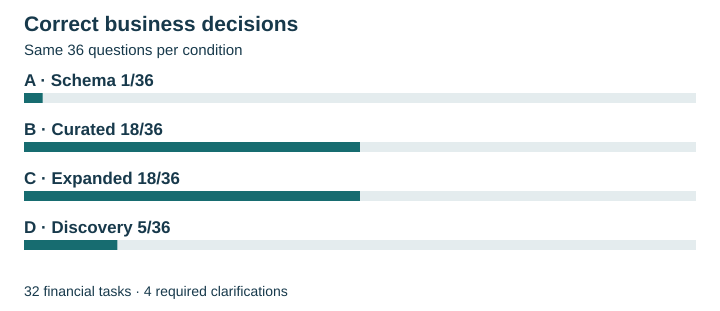
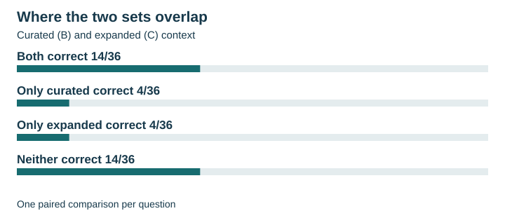
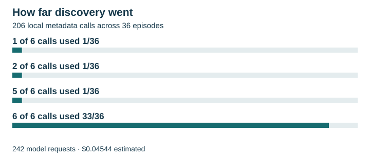

# How Much Business Context Does an AI SQL Assistant Need?

*AI Evaluation Lab · Experiment 005*

## Decision and answer

“What was March net billed cost?” sounds precise until someone has to choose a date column. A cloud service can be used in March and billed on an invoice posted in April. A FinOps analyst needs to know which transactions belong in the report before trusting the total.

**I would start controlled development with curated financial definitions.** On the same 36 questions, the assistant made one correct decision with the schema alone and 18 with curated context. Expanded context also scored 18 and used less estimated inference spend and API time. Even the best observed result leaves half the decisions unresolved or wrong. None of the four workflows demonstrated sufficient reliability for autonomous financial reporting.

## Alternatives and workflow

Meridian is a simulated enterprise cloud-cost warehouse. Its 22 tables represent records such as usage charges, revisions, invoices and allocations. The assistant received a business question and could submit SQL or ask the analyst to resolve an ambiguity. All conditions shared the same reporting-year convention for 2025 and the same exceptions for separately documented January 2026 postings.

| Condition | What the assistant could see |
|---|---|
| A · Schema | Table definitions, columns and keys. |
| B · Curated | A plus a governed package explaining what each row represents, how to join tables, how metrics are defined and which accounting policies apply. |
| C · Expanded | B plus the fuller dictionary, lineage, operational notes and examples from development data. |
| D · Discovery | Started without preloaded warehouse context. It could search the catalog, describe known entries and request examples. Each subsequent model request included the public discovery history, up to six tool calls per question. |

A through C compare preloaded information. B versus D measures a separate architectural choice that also changes navigation, number of requests and how the assistant obtains context.

## Evaluation methodology and results

GPT-6 Luna received each question once per condition at medium reasoning effort. This produced 144 acquired episodes. For 32 questions, a correct decision required a financial result. An independent admission check first screened the proposed SQL for permitted read-only expressions. An isolated DuckDB worker then ran the admitted query on two versions of the warehouse. The same SQL had to return the required columns and values on both, including exact identifiers, monetary amounts to the cent and ordering where specified. Reference SQL and a separate Python calculation cross-checked expected results using shared financial definitions. The two snapshots test the same model answer twice.

Four questions deliberately omitted information needed for a business decision. For credit, the clarification had to ask for that information and declare exactly the required dimensions. Arm-masked, AI-assisted adjudication judged five of 11 distinct question-and-wording entries adequate. Across arms, four episodes earned clarification credit. One otherwise adequate question also declared an unnecessary scope ambiguity.

| Context | All correct /36 | Financial SQL /32 | Clarification /4 | Estimated inference USD | Cumulative API seconds |
|---|---:|---:|---:|---:|---:|
| A · Schema | 1 | 1 | 0 | 0.01057 | 196.692 |
| B · Curated | 18 | 17 | 1 | 0.02749 | 518.762 |
| C · Expanded | 18 | 17 | 1 | 0.02014 | 403.693 |
| D · Discovery | 5 | 3 | 2 | 0.04544 | 738.046 |

<picture>
  <source media="(max-width: 759px)" srcset="assets/meridian-decisions-compact.svg">
  
</picture>

B and C each gained 17 decisions over A with zero losses. Against each other, they traded eight cases. On Q20, B looked up August allocations using month identifier 202508. Meridian stores August as 8. The query ran on both snapshots and missed the financial contract on both. C passed. On Q07, B correctly separated a change in compute spending into volume and rate effects. C proposed a VALUES expression outside the admission rules. Its financial answer remains untested.

<picture>
  <source media="(max-width: 759px)" srcset="assets/meridian-overlap-compact.svg">
  
</picture>

C consumed 217,835 input tokens against B’s 88,739. Much of that input was cached, and C used fewer output tokens (35,670 versus 52,947). At the recorded rates, C cost less. The table sums observed API time across each condition’s workload. Costs come from recorded usage and rates. Invoices, engineering, maintenance and analyst review costs were outside the measurement.

D gained one decision and lost 14 against B. Its gain was Q34, where D asked which cost centers to include and B submitted SQL with the scope unresolved. D had the highest clarification score, on a denominator of just four. It used 242 model requests against B’s 36. Five of 206 local discovery selections returned an invalid-or-oversized result. Thirty-three episodes reached the six-call limit. The study did not vary that limit to measure its effect.

<picture>
  <source media="(max-width: 759px)" srcset="assets/meridian-discovery-compact.svg">
  
</picture>

## One decision trace · which March costs belong on the invoice?

For Q01, “What was March net billed cost?”, the reporting year was already settled. A filtered charges by the day of usage. Its SQL passed admission and ran on both snapshots. A March usage filter can include charges posted in April and leave out earlier usage posted in March. The resulting totals failed both checks.

B had the closing policy before it wrote SQL. It used the invoice posting period and returned the expected March total on each snapshot. C also passed. D asked whether to net credits and revisions or account for commitment applications. The warehouse already defined the billed-cost basis, so that question deferred an answer the analyst could have received. An analyst reviewing only whether the SQL ran would have accepted A’s query at precisely the point where the financial check caught the mistake. [Question contract and reference totals](../experiment05_oracle_review_v2.md) · [Paired outcomes](../experiment05_scored_results.md)

## My contribution

I approved the acquisition protocol and spending limits, preserved the incomplete historical run, authorized the development pilot and the evaluation separately, and accepted the masked wording review and frozen scores before making the architecture recommendation. Codex carried out implementation, acquisition checks, offline analysis and publication preparation. ChatGPT assisted with the masked wording adjudication. Software checked SQL admission, ran the queries and compared their outputs against the financial keys. The study had no independent financial subject-matter expert validation. [Decision and verification record](../verification.md)

## Recommendation and limits

For a controlled analyst workflow, I would start with a curated package whose accounting definitions have named owners. It is a manageable starting design. Expanded context is a credible alternative, especially given its lower observed cost and API time. I would keep the tested bounded discovery workflow out of the default path.

The proposed production workflow would first resolve material ambiguity with a focused question. It would independently screen SQL, execute it in isolation, compare results with deterministic financial controls where available and escalate unresolved results to an analyst before release. This is a recommendation beyond the four evaluated conditions. A deployment decision would require representative analyst questions, independently reviewed accounting definitions, and measurements of errors and review effort on real work.

Meridian is synthetic. Both reference implementations share accounting assumptions, and matching two datasets cannot prove a query generally correct. Q16 can pass by reproducing balanced invoice controls. Excluding it gives A **1/35**, B **17/35**, C **17/35** and D **4/35**. V3 reused the questions after inspection of the incomplete v2 acquisition, so it is a follow-up on a known question set. The historical v2 prefix and the separate development pilot contribute zero episodes to the v3 denominator. With one model draw per question and condition, the observed differences leave repeatability, deployment economics and generalization open. [Scored report and 36-question ledger](../experiment05_scored_results.md) · [V3 changes after v2](../experiment05_prospective_v3.md)
