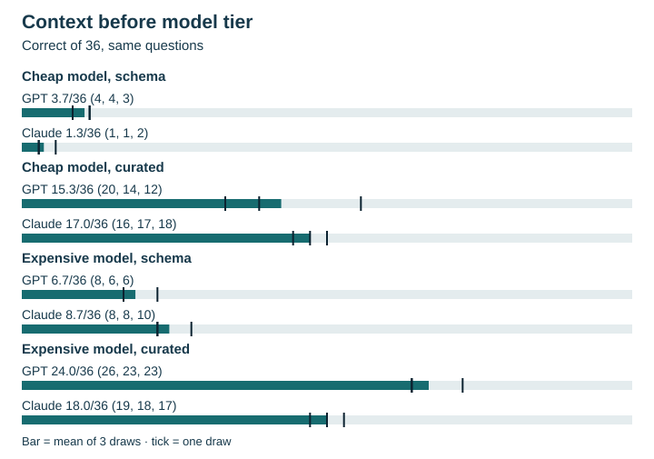
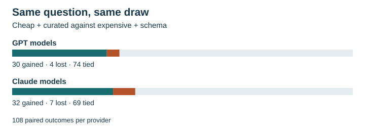

# Should a Finance SQL Assistant Buy a Bigger Model or Better Context?

*AI Evaluation Lab · Experiments 006 and 007*

## Decision and answer

A team building a finance SQL assistant has a limited budget. It can move to a model that costs about 20 times more per token, or it can spend analyst time writing down what its financial terms mean. Experiment 005 showed that curated definitions lifted a low-cost model from 1 to 18 correct decisions out of 36. It did not show whether a larger model would close that gap without the definitions.

**I would invest in curated context first, and price a larger model only once the context exists.** On the same 36 questions, three draws each, the low-cost model with curated context beat the expensive model with the schema alone in every draw, on two providers. GPT models scored 15.3 against 6.7 on average, Claude models 17.0 against 8.7. The cheaper configuration cost 29% and 23% as much, respectively. Even the best configuration, the expensive GPT model with context, made 24 of 36 correct decisions. None of these results supports unreviewed financial reporting.

## Alternatives and workflow

Each study is a 2 × 2 grid on the Meridian warehouse from Experiment 005, a simulated 22-table enterprise cloud-cost warehouse. Every request is a single turn. The assistant returns either one read-only SQL query or one focused clarification question.

| Cell | Model tier | What the assistant could see |
|---|---|---|
| Cheap · schema | `gpt-6-luna` / `claude-haiku-5-5` | Table definitions, columns and keys |
| Cheap · curated | same | Schema plus a governed package of row meanings, join rules, metric definitions and accounting policies |
| Expensive · schema | `gpt-6.1-sol` / `claude-sonnet-5-5` | Table definitions, columns and keys |
| Expensive · curated | same | Schema plus the same curated package |

The two cheap models have identical standard token rates, as do the two expensive models. The expensive rates are 20 times the cheap rates for input and output. Experiment 006 ran the GPT pair. Experiment 007 replicated it on the Claude pair with the same questions, draw order and grading, after pre-registering what replication would mean. Self-directed discovery, Experiment 005's weakest condition, was left out.

## Evaluation methodology and results

Each cell answered each of the 36 questions three times, for 432 requests per study. For 32 questions, a correct decision required SQL that passed an admission check and returned the expected typed result on two versions of the warehouse in an isolated DuckDB worker. Four questions deliberately left out information needed to answer. For those, the assistant had to ask for the missing dimensions with adequate wording, judged on a worksheet that hid the model, context and draw.

| Configuration | GPT mean /36 (draws) | GPT usage-priced cost | Claude mean /36 (draws) | Claude usage-priced cost |
|---|---:|---:|---:|---:|
| Cheap · schema | 3.7 (4, 4, 3) | $0.0366 | 1.3 (1, 1, 2) | $0.0415 |
| Cheap · curated | 15.3 (20, 14, 12) | $0.0776 | 17.0 (16, 17, 18) | $0.1231 |
| Expensive · schema | 6.7 (8, 6, 6) | $0.2677 | 8.7 (8, 8, 10) | $0.5390 |
| Expensive · curated | 24.0 (26, 23, 23) | $0.4433 | 18.0 (19, 18, 17) | $0.9055 |

Costs cover each cell's 108 requests at the recorded usage and standard rates, including this run's prompt caching.

<picture>
  <source media="(max-width: 759px)" srcset="assets/context-tier-means-compact.svg">
  
</picture>

Curated context raised every model in every draw. Adding it moved each model further than switching models moved either context level. On GPT models, context added 11.7 for the cheap model and 17.3 for the expensive one, while switching tier added 3.0 without context and 8.7 with it.

Paired on the same question and draw, the cheap model with context gained 30 decisions and lost 4 against the expensive model without it on GPT models. On Claude models it gained 32 and lost 7.

<picture>
  <source media="(max-width: 759px)" srcset="assets/context-tier-paired-compact.svg">
  
</picture>

The providers differed on the expensive model with context. Sol with context clearly led Luna with context, 24.0 against 15.3. Sonnet with context finished nearly level with Haiku with context, 18.0 against 17.0, with 22 paired gains and 19 losses. Part of that gap was output format. Claude broke the required single-JSON-object format in 44 of 432 answers, 18 of them from Sonnet with context, and the pre-registered rules score those answers as incorrect. A post-hoc analysis, added after seeing those failures, re-read the 44 answers with lenient JSON extraction. Sonnet with context then averaged 22.7 against Haiku's 19.0, and the headline comparison still held in every draw. That analysis is descriptive only. For a deployment it argues for structured outputs or a tolerant parser on Claude models. It says nothing about financial reasoning.

Repeated draws also changed how Experiment 005 should be read. Luna with context scored 20, 14 and 12. Its single 005 result of 18 was one sample from that range. Only 8 of 36 questions were correct in all three draws for that cell.

The cheaper configuration was not faster. The cheap models reasoned at much greater length with context. Average API time per request was 13.8 seconds for Luna with context against 5.8 for Sol with schema, and 9.2 seconds for Haiku with context against 4.0 for Sonnet with schema. Both full studies together cost $2.43 in recorded usage.

## One decision trace · which sign does a credit carry?

Q17 asks, “How much October-posted credit refers to September usage?” The reference answer is a signed USD amount, −296.00 on the first warehouse snapshot. The cheap model with context answered it correctly in all six draws across the two studies. The expensive model without context missed it in all six.

The expensive schema-only queries were mostly well built. They kept the latest revision of each charge, filtered by the invoice posting month and selected credit rows. Then every one of them flipped the sign. Sol returned `-SUM(billed)` in each draw. Sonnet returned `-SUM(billed)` once and `SUM(ABS(billed))` twice. Sol also hedged on the month encoding in two draws, accepting either 10 or 202510. Each query reported a positive credit, and each failed on both snapshots.

Without context, the cheap models did not guess. In all six draws, Luna and Haiku asked which amount column should define the credit, such as billed, effective or contracted. Q17 needs a financial answer, so each clarification scored as incorrect.

The curated package's closing policy says that signed credit postings are included in net billed and that the charge day is the economic usage clock. With that sentence available, both cheap models returned the signed billed sum. One Sonnet answer with context explained its reasoning before the JSON, citing “the policy that signed credits are included.” That prose broke the format rule, so it scored as incorrect, but the reasoning shows where the convention came from. The larger model had the SQL skill. It lacked the convention. An analyst checking only whether the query ran would have accepted a credit with the wrong sign. [006 scored results](../experiment06_scored_results.md) · [007 scored results](../experiment07_scored_results.md)

## My contribution

I chose the models, context levels and number of draws for Experiment 006, approved both designs, the frozen request sets and the $15 spending caps, and supplied the API credentials in my own environment. For 007 I required pre-registered replication criteria before any request was sent. Claude drafted the designs and carried out implementation, acquisition checks, offline analysis and publication preparation. Because Claude designed both studies, it did not judge clarification wording on its own models. In 006, Claude drafted judgments on the 17 masked GPT wordings and I accepted them without amendment. In 007, I reviewed all 14 masked Claude wordings myself, item by item. Software checked SQL admission, ran the queries and compared results against the financial keys. No independent financial subject-matter expert reviewed the work. [Decision and verification record](../verification.md)

## Recommendation and limits

For a team deciding where to spend first, I would fund curated financial definitions with named owners before upgrading the model. On this workload the low-cost model with context beat the expensive model without it in all six draws across two providers, at roughly a quarter of the cost. Once the context exists, the larger model's value depends on the vendor. It added 8.7 decisions on GPT models and 1.0 on Claude models under strict format rules. A team should measure that on its own questions before paying for it. Whatever the model, I would keep the release controls recommended after Experiment 005: resolve material ambiguity with a focused question, screen and isolate SQL, compare against deterministic financial controls where they exist and route unresolved results to an analyst.

The questions were inspected during Experiment 005, so they are not a fresh holdout, and the warehouse is synthetic. Reasoning effort, tokenizers and cache lifetimes are not calibrated across providers, and the prompts were developed on GPT models, so the two columns do not rank the providers. Three draws describe variation on this workload and do not support significance claims. The format-lenient scores were chosen after the run. Costs are usage-priced and exclude curation effort, engineering and analyst review. The curated package already existed from Experiment 005, so these studies say nothing about what it costs to write one. [006 design](../experiment06_model_context_design.md) · [007 design](../experiment07_claude_replication_design.md)
