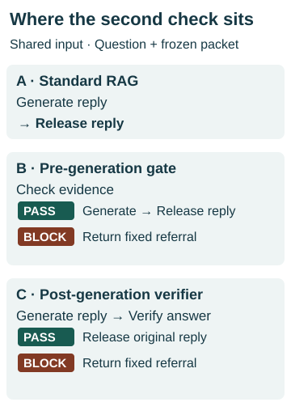
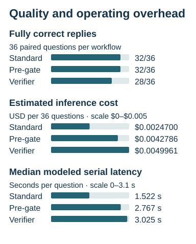
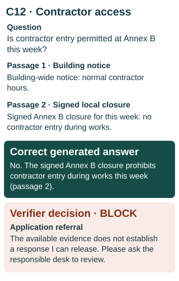

# Which RAG Reliability Safeguards Are Worth Deploying?

*AI Evaluation Lab · Experiment 03*

In a synthetic facilities case, an employee asked whether contractors could enter Annex B that week. The evidence packet supplied to the assistant included a signed closure for Annex B. The assistant cited it and correctly said no. A model assigned to verify that answer blocked it. The employee-facing reply became “Please ask the responsible desk to review.”

**I would start with standard retrieval-augmented generation (RAG) for this workload.** It gave a fully correct reply on **32 of 36** questions. Checking the evidence first preserved all 32. Checking the answer before release reduced the count to **28 of 36** and increased estimated inference cost by **102.3%**. Neither safeguard caught an unsupported answer that the baseline would have delivered.

## Three ways to answer the same question

For a support desk, a referral has a cost. Someone else has to interpret the policy, and a user may have to wait. The implementation decision was whether a second model call catches enough consequential errors to justify the useful replies it withholds.

<picture>
  <source media="(min-width: 760px)" srcset="assets/rag-workflows.svg">
  
</picture>

*All three workflows start with the same preselected packet. The pre-gate checks the evidence. The verifier sees the answer as well.*

The baseline could cite the packet, explain what it supported, ask for clarification or abstain. The pre-gate could identify missing evidence before paying for generation. The post-check could inspect a specific claim or citation, but generation had already occurred. Neither check could retrieve another document or rewrite the answer.

## How I isolated the effect of a check

The first pilot used **24 fictional service-desk questions**. The gate blocked six, and the baseline had already abstained appropriately on every one. Both workflows scored 23/24. Both also attributed a collection code to the wrong issuer. That left a practical question open. Would checking the *actual reply* help on harder evidence conflicts?

Phase B used **36 new synthetic questions** with equal groups of routine requests, incomplete or ambiguous evidence, and conflicting or outdated documents. In both phases, the passages for each question were preselected and frozen before generation. Live retrieval and ranking were outside the experiment. In Phase B, all three workflows used the same packet and one shared generator reply for each question. A PASS forwarded that reply verbatim. A BLOCK substituted the same fixed referral. The verifier saw the generated answer alongside the evidence. The 108 workflow outcomes reduced to 40 distinct question/reply pairs for masked grading. The unit of comparison was the question.

## What changed for the user

| Workflow | Fully correct replies | Estimated inference cost for 36 questions | Median modeled serial latency per question |
|---|---:|---:|---:|
| Standard RAG | 32/36 | $0.0024700 | 1.522 s |
| Pre-generation gate | 32/36 | $0.0042786 | 2.767 s |
| Post-generation verifier | 28/36 | $0.0049961 | 3.025 s |

The cost estimates apply the study’s prices to recorded token usage. Latency adds the measured stages for each question before taking the median. Retrieval, queueing and staff handling time were outside the measurement.

The gate passed all 36 packets. The verifier changed four replies. It withheld two correct policy answers (maintenance and Annex B access), a question that would have identified the right campus for a key replacement, and an explanation of why a dry-freight payout limit could not settle a refrigerated claim. The last case, I03, remained safe after referral but lost the reason for abstaining. Its generic referral is incomplete under the frozen key.

The baseline’s four misses were safe but incomplete. For example, one reply correctly declined to compute a covenant ratio from incomplete records but omitted the requested formula. Counting only invented facts would have missed that failure to help the user.

## C12 · When a verifier suppressed the governing rule

<picture>
  <source media="(min-width: 760px)" srcset="assets/rag-c12.svg">
  
</picture>

*The signed local closure answered the question. The verifier blocked the scoped reply, and the application returned a referral. A workplace delay is hypothetical.*

The building-wide notice set normal hours. The signed closure applied to this annex, this week, during the works. Standard RAG cited that narrower rule, and the evidence gate allowed the same answer through. The observed verifier decision was BLOCK. The resulting referral asked the user to contact the desk. **A delay while someone rechecks the closure is a hypothetical business consequence.** The study measured the reply change. It did not observe an employee, a site visit or a delay.

## What I would recommend to a customer

Start with a grounded baseline that can say what the evidence establishes and where it runs out. Sample real questions with the desk owner and trace each material error back to the packet, the reply and the decision it informed.

| What the trace shows | What I would pilot |
|---|---|
| A current signed rider never reached the assistant, or a draft outranked it. | Repair retrieval, document status and scope. Check how often the governing document reaches the packet. A second model reading the same documents cannot supply the missing rider. |
| Support routinely promises an exception without the required evidence. | Shadow a pre-gate with explicit sufficiency criteria. Count unsafe promises it would prevent and useful partial answers or clarifications it would withhold. |
| Finance summaries repeatedly misquote a term even with the governing document in view. | Use a deterministic check for a defined calculation. For interpretation errors, shadow a verifier selectively on the consequential claims and inspect both its catches and its misses. |
| The documents leave a discretionary or high-impact approval unresolved. | Route the evidence and open decision to a named person with authority. Measure queue time and whether the referral leads to a decision. |

I would add verification only if representative traffic shows that the frequency and severity of errors it actually prevents outweigh useful answers lost, review labor, inference cost and delay. I would track those quantities alongside tail latency and audit a sample of both passed and blocked replies. Selective verification is a proposed customer pilot. This experiment evaluated checks applied to every question. [FDE Deployment Decision Playbook](../fde_deployment_playbook.md)

## My contribution and the limits of the evidence

I directed the architecture comparison, reviewed and strengthened the scenarios, approved the two acquisition stages separately, and required the evaluation to count useful answers a safeguard withheld. Codex assisted with implementation, acquisition audits and paired reporting. I reviewed and accepted the AI-assisted judgments and their documented sensitivities. There was no independent human adjudication.

One case matters to the interpretation. I04 used invalid citation IDs and omitted the severity qualifier on a 15-minute acknowledgment target. Counting it incorrect lowers the scores to **31/36, 31/36 and 27/36**. All three workflows released the same text. On C06, the question asked for active sites, but the source established only total sites. The accepted grade credits the reply for making that distinction explicit.

These 36 synthetic questions used fixed evidence packets, one generator draw per question and one model family. A conservatively prompted baseline left few opportunities to demonstrate prevention. A checker from the same family can share the generator’s mistakes. The study establishes a cost and usefulness trade-off on this workload. Production error rates, business ROI and the value of verification where serious errors are more common remain open. [Accepted paired findings](../experiment03_paired_findings.md) · [Grading audit and sensitivities](../experiment03_phase_b_review.md) · [Phase A findings](../experiment03_phase_a_review.md)
