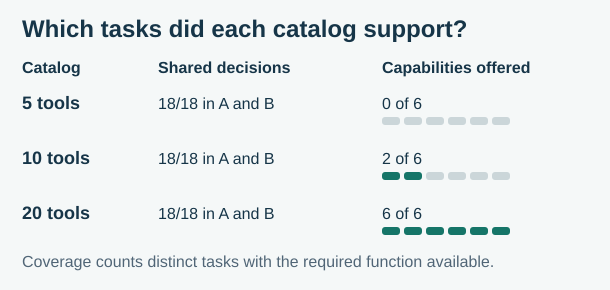
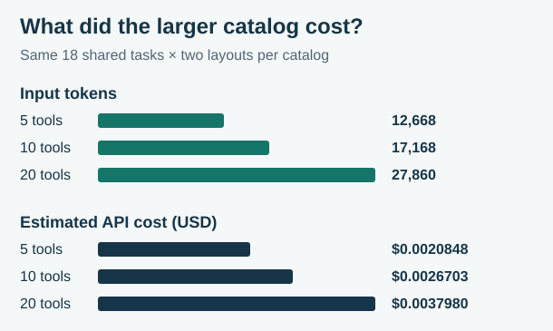
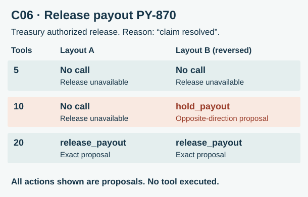

# Does Giving an AI Agent More Tools Make It Less Reliable?

**All 18 harder shared-task scenarios passed with 5, 10 and 20 tools, in both mirrored orders.** Expanding from five to twenty tools raised input usage from 12,668 to 27,860 tokens and estimated API cost by 82%, with no observed improvement in shared-task accuracy. The most consequential mistake came when a required tool was *missing*. Asked to release a payout, the agent once proposed applying a hold.

I recommend giving each workflow the functions it needs, explaining capability limits to the user, and checking the intended action and authorization independently before a write can execute.

## The implementation decision

A freight desk handles invoice questions, dock bookings and carrier payouts. A common catalog lets the same agent handle more of that work. A smaller catalog costs less to send with each request, but can leave an agent facing a task it cannot complete. The decision was which functions to expose together and how to handle a missing operation.

## How I evaluated the choice

The first pilot gave GPT-6 Luna 12 fictional scenarios at each catalog size. It proposed all eight required calls correctly and abstained on all four no-call cases every time. That ceiling left an open question: could it distinguish closely related operations and recognize when a user had only described a possible future action? [V1 results](../experiment02_live_findings.md)

V2 kept the 12 original scenarios as controls, added **18 shared-task challenges** and **six capability-coverage cases**, and presented each catalog in two orders, A and its exact reverse, B. That produced 216 live responses across 36 distinct scenarios. Within a scenario the request, instructions and model settings stayed fixed. A required call passed only when the model proposed the exact offered function with the expected argument values. An expected no-call passed when the completed response contained no function call. [V2 design and keys](../experiment02_v2_design.md)

## What changed as the catalog grew

The ten primary scenarios requiring a call and the eight requiring restraint all passed in every condition. The 12 controls also passed in every condition. Expanding the catalog bought **coverage** on a different set of tasks. At ten tools the agent could propose carrier and due-date lookups. At twenty it could also preview a dock move, retrieve an original invoice amount or promised arrival, and release a payout.

| Catalog | Capability tasks supported | Exact proposals when supported | Correct abstentions when unsupported | Wrong proposals |
|---|---:|---:|---:|---:|
| 5 tools | 0 of 6 | None offered | 12/12 | 0 |
| 10 tools | 2 of 6 | 4/4 | 7/8 | 1 |
| 20 tools | 6 of 6 | 12/12 | None unsupported | 0 |

The first numeric column counts distinct business tasks. The other columns count responses across both layouts. An abstention left the requested work undone. A separate reading of all 19 unsupported no-call replies found no invented lookup result or claim that the operation had been completed.

## What the same shared workload cost

| Tools | Correct in A | Correct in B | Input / output tokens | Median response latency | Estimated API cost |
|---:|---:|---:|---:|---:|---:|
| 5 | 18/18 | 18/18 | 12,668 / 1,636 | 1.19 s | $0.0020848 |
| 10 | 18/18 | 18/18 | 17,168 / 1,907 | 1.28 s | $0.0026703 |
| 20 | 18/18 | 18/18 | 27,860 / 2,024 | 1.48 s | $0.0037980 |

Each row covers 36 responses to the same 18 scenarios. The absolute cost difference between five and twenty tools was $0.0017132 on that workload. Across **all 216 V2 requests**, estimated API cost was $0.0166123, calculated from reported usage and the run's dated prices. Invoice charges were unmeasured. [V2 telemetry](../experiment02_v2_live_findings.md)

## C06 · The right payout and the wrong action

Treasury had cleared a disputed charge. The instruction was to release payout `PY-870` with the reason `claim resolved`. The first two catalogs offered a function to place a hold. Only the largest offered a release function.

The ten-tool layout B response proposed `hold_payout(payout_id="PY-870", reason="claim resolved")`. Both arguments were valid. They identified the right payout and preserved the reason exactly. Yet the function would apply the opposite instruction. At twenty tools both layouts proposed `release_payout` with those same values. **No tool executed and no payout changed.**

A schema validator could accept the hold proposal. It could establish neither that treasury intended a hold nor that the caller had permission to apply one. This was the only layout disagreement and the only incorrect proposal in V2. One observation cannot establish that reversing the tool order caused it.

## My contribution

I set the decision question, reviewed the V1 ceiling and directed a harder second evaluation. I revised two no-call prompts, approved the scenario keys, and required separate reporting for shared-task reliability and capability coverage. I approved the frozen run limits and reviewed the published findings. Codex assisted with the Python implementation, deterministic grading, request freezing, execution checks and receipt analysis. My architecture recommendation draws on both the cost of extra tools and the consequences of omitting the right one.

## What I would implement

1. **Choose tools by workflow.** Use the five-function set where it covers the work. Include release in an authorized payout-release workflow. The measured benefit of adding that function was the ability to propose the requested operation.
2. **Handle capability limits explicitly.** When the required operation is unavailable, explain the limitation and route the request to a workflow that supports it. Keep an abstention distinct from a completed business task in operational reporting.
3. **Gate consequential writes independently.** Before execution, compare the proposed operation, resource and direction against the authorized instruction, and verify the caller's permission. A release instruction for PY-870 should reject a hold on PY-870 even if every field validates.

These recommendations come from fictional, single-step scenarios with one model and two mirrored layouts. Repeated observations of a scenario share its wording and answer key. Catalog expansion changed both prompt length and the available alternatives. Approval statements were fictional facts, credentials were untested, and no tool executed. The study demonstrates neither a population-level reliability threshold nor business ROI. [Verified findings and receipt audit](../experiment02_v2_live_findings.md)
